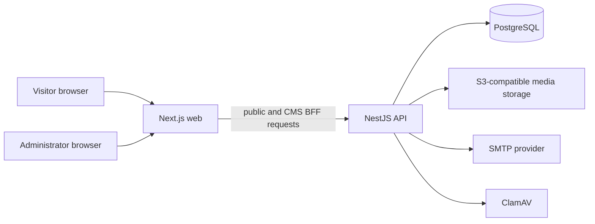

# Architecture

## System overview

TEVONIQ is a monorepo with a Next.js public/admin application, a NestJS API, PostgreSQL, and pluggable storage and delivery services.

The browser only reaches the public web application and its explicit BFF routes. Browser session tokens remain in an HttpOnly cookie at the web layer; the BFF converts them to an API bearer credential on private server-to-server requests.

## Frontend

`apps/web` uses the Next.js App Router. Public pages are server-rendered and localized under `/{locale}` for English, Turkish, and Arabic RTL. Interactive elements such as forms, consent settings, menu controls, and CMS editors are client components; content pages remain server components where possible.

The locale layout resolves published settings, navigation, SEO structure, header, footer, and consent-aware analytics. It installs a per-request CSP nonce and sends `private, no-store` for HTML because nonce-bearing documents must not be shared from a cache.

The CMS BFF at `apps/web/src/app/api/cms/[...path]/route.ts` allowlists routes and methods, checks the exact browser origin for writes, bounds request bodies, forwards only its server-held API credential, and expires public-content cache tags after successful editorial writes.

## Backend

`apps/api` is a NestJS service with controllers grouped by public catalogue/content access and CMS administration. A global authorization guard uses an allowlist for public endpoints; every other handler needs an explicit permission policy. Strict Zod schemas validate external input before it reaches services or Prisma.

Public forms use dedicated rate limits, origin checks, optional Turnstile verification, idempotency controls, and background email processing. The API exposes liveness and readiness endpoints for orchestration.

## Database and migrations

PostgreSQL is accessed through Prisma with the PostgreSQL driver adapter. The schema models settings, translations, CMS users/sessions/audit entries, media, catalogues, page-builder documents, leads, applications, newsletters, and background work. Public catalogue indexes target publication state, locale, slug, and sort order; CMS mutations use transactions and optimistic version fields where records can be edited concurrently.

Committed migration history lives in `apps/api/prisma/migrations`. Generate migrations only in a development database, review the generated SQL, and apply them in production with `npm run db:deploy` using a separate migration identity. The development seed creates inactive draft records only and is blocked outside `NODE_ENV=development`.

## CMS and publishing

The CMS separates draft/editing data from the public projection. Public endpoints select only active, published records and translations. Site settings return an explicit public allowlist so operational mail routing, storage controls, security configuration, and credentials never reach the browser.

Projects can represent public, anonymous, or private client relationships. Partners, testimonials, and other home-page records are rendered only when published and marked verified. Empty collections render honest unavailable or empty states; the application has no public fallback catalogue or fabricated metrics.

## Authentication and RBAC

Passwords use scrypt and session tokens are random opaque values stored as hashes. Sessions expire and are invalidated on security-sensitive changes. The web cookie is HttpOnly, SameSite=Strict, path-scoped to the CMS BFF, and Secure for HTTPS sites.

Roles map to granular permissions for content, publishing, media, leads, hiring, newsletter operations, settings, audit records, users, and role management. Authorization is evaluated on the server from database roles, never from browser-provided role claims. See [SECURITY.md](SECURITY.md) for the detailed control set.

## Storage and external services

Development can use local media storage; production requires S3-compatible storage. Public media is delivered as safe, bounded image variants with immutable caching. CVs and quote attachments use authorized download routes, attachment responses, `no-store`, and malware scanning. Treat the public media library as public data.

SMTP, S3, Turnstile, ClamAV, and trusted ingress settings are operator configuration. The application does not expose an arbitrary URL-fetch facility; outbound destinations are fixed providers or constrained configuration.

## Localization and SEO

The enabled locale list lives in site settings. Route validation, direction, language switching, metadata alternates, sitemap records, and structured data all use those settings and validated localized paths. Arabic uses RTL direction and an Arabic font range.

SEO defaults, page overrides, canonical URLs, Open Graph values, and JSON-LD come from settings and approved content. JSON-LD escapes unsafe characters before serialization. Unpublished or missing localized content returns a non-indexable response.

## Caching and performance

Published CMS data uses Next’s data cache with a five-minute revalidation window and the `cms-public-content` tag. Successful CMS mutations immediately expire that tag so the next public request receives fresh content. Authenticated CMS traffic, forms, search, uploads, private downloads, and BFF responses are `no-store`.

Static Next assets, fonts, brand assets, and published media are suitable for immutable CDN caching. In a multi-instance deployment, configure a shared Next data-cache implementation so tag invalidation reaches all web instances. More detail is in [docs/performance-optimization.md](docs/performance-optimization.md).
