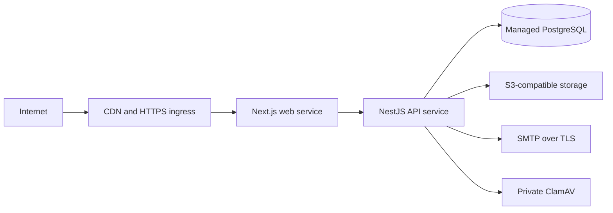

# Deployment

## Supported production shape

Deploy the web and API as separate stateless services behind HTTPS ingress, with managed PostgreSQL, S3-compatible media storage, a private ClamAV service, and a managed secret store. Run migrations as a short-lived release job using a dedicated migration identity.



Keep PostgreSQL, the API, ClamAV, and object storage control-plane endpoints off the public internet. Permit browser access only to the web service and explicit public media delivery paths.

## Deployment options

| Option              | Suitable use                                                            | Required adaptation                                                                                                           |
| ------------------- | ----------------------------------------------------------------------- | ----------------------------------------------------------------------------------------------------------------------------- |
| Managed containers  | ECS/Fargate, Cloud Run, Azure Container Apps, Fly.io, or Kubernetes     | Build the `web`, `api`, and `migrate` Docker targets; inject runtime secrets; configure private networking and health checks. |
| VM/container host   | A small controlled deployment with Docker Engine and a managed database | Run the web/API images under a process supervisor and place them behind a managed TLS reverse proxy.                          |
| Platform buildpacks | Platforms that support Node 24 and separate services                    | Run the same build commands, inject environment variables at runtime, and use a one-off migration release command.            |

The repository `compose.yaml` is a local preview reference. It binds ports to loopback and should not be treated as a full production topology.

## Release procedure

1. Run `npm ci`, `npm run lint`, `npm run typecheck`, `npm test`, the embedded integration test, `npm run test:e2e`, and `npm run build` from a clean checkout.
2. Build immutable images from the reviewed commit. Do not provide secrets as build arguments and do not copy local `.env`, `.data`, logs, test output, or private keys into the build context.
3. Provision production environment values through a secret manager. Set `NODE_ENV=production`, an HTTPS `SITE_URL`, exact `CORS_ORIGIN`, private API/database URLs, S3 settings, scanning settings, and mail configuration as required.
4. Run `npm run db:deploy` once with a restricted migration role before switching application traffic. Back up the database first and confirm the migration completes successfully.
5. Deploy the API, wait for `/api/v1/health/ready`, then deploy the web service and wait for `/health`.
6. Create or rotate the initial administrator with `npm run cms:admin` in a one-off secure environment. Require identity-aware ingress or VPN with MFA for `/admin`.
7. Validate the public localized pages, consent behavior, CMS write origin protection, a least-privileged editor role, media uploads/scanner failure behavior, email delivery, security headers, and backups.

Use a rolling or blue/green deployment only when the migration is backward compatible with both application versions. For destructive schema work, use an expand/migrate/contract sequence and keep a tested backup/restore path.

## Runtime configuration

Production media uploads require `MEDIA_STORAGE=s3`; the API exits if local storage is selected. `MEDIA_STORAGE=disabled` is supported for previews that do not offer media uploads. Use private bucket permissions for the API role, separate credentials by environment, and serve only intended public media through the application/CDN path. Configure SMTP over TLS, and keep `TURNSTILE_SECRET_KEY`, S3 credentials, `DATABASE_URL`, and `LEAD_PROXY_SECRET` in the secret manager.

Set `LEAD_CLIENT_IP_HEADER` only when the ingress removes any client-supplied copy, adds its own value, and blocks direct access to the web/API origin. Configure `LEAD_PROXY_SECRET` with the same high-entropy secret in both web and API services.

Analytics and marketing IDs belong in site settings and load only after the applicable stored consent. Never place vendor tokens or arbitrary script source in settings.

## Caching, CDN, and scaling

Cache `/_next/static/*`, `/brand/*`, `/fonts/*`, and public media with their supplied immutable cache directives. Do not share-cache HTML or CMS API responses: HTML carries a request-specific CSP nonce and CMS responses are private.

Public CMS data uses Next’s tagged data cache. A multi-replica deployment needs a shared cache implementation or coordinated invalidation so CMS publishing takes effect consistently across replicas.

The current global HTTP limiter is process-local. Before horizontally scaling the API, add a distributed ingress/API limiter and shared operational controls. Redis is defined as an optional local service but is not consumed by the application today.

## Observability and operations

- Collect structured application logs without request bodies, query strings, cookies, authorization headers, or form data.
- Alert on API readiness failures, worker/email failures, scanner failures, elevated 4xx/5xx rates, database capacity, backup failures, and storage errors.
- Retain and protect audit logs according to the applicable privacy policy. Set concrete retention and deletion schedules for leads, CVs, newsletters, queued mail, and backups.
- Back up PostgreSQL and media, encrypt backups, regularly restore into an isolated environment, and document recovery time and recovery point objectives.
- Scan release images and dependencies in CI, keep the Node base image patched, and protect deployment credentials and release branches.

## Rollback

Keep the previous immutable web/API images available. If a release fails health or functional checks, stop new traffic, roll back application images, and investigate before retrying. Do not roll a database migration back automatically; restore or apply a reviewed forward corrective migration after assessing data integrity.

For a security incident, follow the containment and credential/session-revocation guidance in [SECURITY.md](SECURITY.md). For routine post-release failure, preserve safe logs and deployment metadata, identify the failed dependency, then record a corrective action before the next release.

## Initial editorial content transfer

A fresh production database needs content as well as schema migrations. The local service import scripts intentionally refuse production targets. Use the allowlisted transfer instead:

```sh
# Export the current local editorial database to a new private file.
node scripts/editorial-transfer.mjs export .data/release/editorial.json
```

Review the bundle before release. It excludes source users, sessions, password resets, leads, attachments, job applications/CVs, subscribers, mail jobs, throttles and historical audits. It includes editorial drafts and published snapshots, company settings and notification recipients. Transfer media binaries separately; the importer refuses local media metadata until it has been migrated to S3.

On the target, first apply migrations and provision the production SUPER_ADMIN. Inject the target `DATABASE_URL` through the secret manager; the import command deliberately does not load local `.env` files. Preview counts, then apply using that administrator's UUID:

```sh
node scripts/editorial-transfer.mjs import /secure/editorial.json
node scripts/editorial-transfer.mjs import /secure/editorial.json --apply --actor=PRODUCTION_SUPER_ADMIN_UUID
```

Apply is atomic and refuses to overwrite any existing editorial records. Perform this initial import before editing target settings. Editor attribution is reassigned to the target administrator. Start/restart the web service after import, check public URLs and storage, and back up the production database. This transfer is not an incremental content synchronization tool.

Validate prepared environment files without displaying their values:

```sh
node scripts/check-release-env.mjs /secure/api.env /secure/web.env
```

This checks structure, placeholders, the tevoniq.com origin, storage mode, scanner configuration, trusted forwarding secrets and SMTP enablement. Passing it does not verify external connectivity or delivery; those require deployment smoke tests.

## Free Render preview

The root `render.yaml` provisions exactly one free Node web service and one free Postgres database. `scripts/render/build.mjs` builds both apps and assembles Next standalone assets; `scripts/render/start.mjs` applies migrations, bootstraps a distinct admin and reviewed content once, then supervises the loopback-only API and public web process. Upload storage and email are disabled. The preview does not use S3 placeholders or ephemeral uploads as a substitute for persistent storage.

This is an explicitly limited preview profile, not the production topology described above. Free Postgres expires after 30 days, free services sleep, and the shared free-hour allowance applies. SMTP's common ports are blocked on the free tier; use a supported HTTPS mail integration or change hosting tier before enabling mail. See [the Render preview guide](docs/render-free-ar.md) before creating resources.
